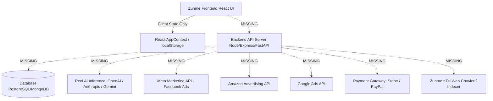
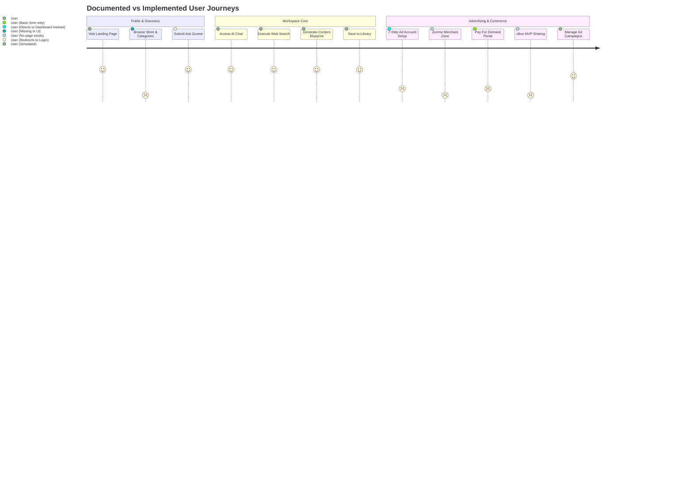

# Zunme AI — Read-Only UI Audit Report Against Client Documents

**Audit Date:** October 16, 2026  
**Audited Documents:**  
1. `document/Home - zunme - website entry point.docx`  
2. `document/Major Types of Ads - zunme.docx`  
**Audit Mode:** Strict Read-Only Mode (Zero application source code, configuration, or live data modified)

---

## A. Executive Summary

This audit evaluates the current Zunme AI frontend codebase against the two client requirement documents: `Home - zunme - website entry point.docx` (Document A) and `Major Types of Ads - zunme.docx` (Document B).

### 1. Overall UI Coverage: ~62%
- **Implemented Core Modules:** The general consumer and business productivity interfaces are well-structured, including the Landing Page (`/`), Conversational AI Chat (`/app/chat` / `/user/chat`), Live Web Search (`/app/search`), AI Content Builders (`/app/builders`), AI Warehouse (`/warehouse`), Personal Library (`/app/library`), SEO Workspace (`/seo`), Multi-Channel Social Scheduler (`/social`), Creator Studio (`/creator`), and Admin / Super-Admin consoles (`/admin`, `/super-admin`).
- **Major Documented UI Absences:**
  1. **Zunme Store & Categories:** Document A specifies a top-level "Store / Zunme Shop" entry point with 6 distinct sub-categories: *AI Content, Animation, Cartoon, Images / Photos, Videos / AI Videos, and AI Builder*. Neither the Store navigation link nor its category interfaces exist in the UI.
  2. **Zunme 7-Step Advertising Account Setup Wizard:** Document A outlines an explicit 7-step onboarding flow (*Sign Up / Zunme Pro, Business Information, Product Data / Feed, Advertising Objective, Target Audience, Budget, Ad Creation*). The current Ads platform (`/ads`) starts directly in a self-serve campaign dashboard without this guided setup journey.
  3. **Zunme MPA, Merchant Zone & Pay For Demand Dedicated Interfaces:** Document A defines Zunme MPA (Multi-Platform Advertising), Zunme Merchant Zone (product listing management, free listings, and Shopify automatic sync), and Pay For Demand. These are referenced as conceptual frameworks in the document but lack dedicated standalone portals or navigation endpoints.
  4. **zBox Communication & Cross-Platform Content Sharing Interface:** Document A details a Gmail-like communication tool with a specialized "MVP" (Most Visited Platforms) selector to share content across Google, Facebook, Instagram, YouTube, TikTok, LinkedIn, Amazon, and X. This feature is absent from the application.
  5. **Advertising Formats Diversity (Document B):** Document B describes 13 Facebook ad formats, 4 Amazon ad formats, and 9 Google ad formats. The existing Ads platform (`/ads`) only provides 3 native placement types (*Sponsored Search Suggestion, Native Studio Placement, Featured Partner Asset*) and an interactive preview for Google Search SERP, Mobile, and In-Feed. It lacks specific format builders for formats like Facebook Carousel, Collection, Instant Experience, Lead Ads, Playable, AR, or Amazon Sponsored Products/Brands/DSP.

### 2. Overall Functional Coverage: ~18% (Production-Ready) / ~80% (Interactive Mock / Simulation)
- The existing frontend is entirely client-side driven via React Context (`AppContext.tsx`), component-level state, and browser `localStorage`.
- There is no active backend API server, database connection, real AI model routing (OpenAI/Anthropic/Gemini APIs), real web crawler/grounding engine, or real advertising network integration (Meta Marketing API, Amazon Advertising API, Google Ads API).
- All statistics, keyword auctions, ad spend calculations, connected social channels, and sync operations function as interactive prototypes.

### 3. Key Risks & Verification Limitations
- **Verification Environment:** All tests were executed in a local development environment. External API testing was not performed because third-party live API keys, ad account IDs, and OAuth secrets are neither configured nor provided.
- **Data Persistence:** Clearing browser cache/localStorage resets all campaigns, custom keywords, created assets, and login sessions to default seed mock data.

---

## B. Requirement-by-Requirement Audit Matrix

| ID | Source Document | Page/Section | Requirement | Status | UI Evidence | Functional Evidence | What's Missing | Recommended Next Step |
| :--- | :--- | :--- | :--- | :---: | :--- | :--- | :--- | :--- |
| **REQ-01** | Doc A | Lines 2-4 | Zunme branding, logo, homepage and platform positioning ("AI Workspace for Ideas, Content & Discovery") | **Functional (Frontend)** | [LandingPage.tsx](file:///d:/Kiaan/Zunme-AI-/Frontend/src/pages/LandingPage.tsx#L560-L570) displays the exact headline and supporting text with official `zunme_logo.png`. | Client-side React rendering; responsive down to 320px screen widths. | None for public landing text. | Maintain current landing hero presentation. |
| **REQ-02** | Doc A | Line 6 | Dedicated AI capabilities organized into one seamless workspace (AI Chat, Web Search, Content Builders, AI Warehouse, Creator Tools, SEO Workspace) | **UI Present / Partially Functional** | Top-level routes: `/app/chat`, `/app/search`, `/app/builders`, `/warehouse`, `/creator`, `/seo`. | Connected through `AppShell.tsx` navigation and `AppContext.tsx` state handlers. | Backend persistence and live model inference. | Connect existing UI handlers to real backend microservices. |
| **REQ-03** | Doc A | Lines 1, 22-29 | **Store & 6 Categories:** Zunme Shop, AI Content, Animation, Cartoon, Images / Photos, Videos / AI Videos, AI Builder | **Missing** | Header has links for Features, How It Works, Product, Pricing, FAQ. No "Store" or "Zunme Shop" link exists. | No route or component found matching `/store` or `/shop`. | Complete dedicated Store UI with the 6 specified sub-categories. | Create a dedicated `/store` route and navigation dropdown with category cards. |
| **REQ-04** | Doc A | Lines 35-44 | **Advertising Account Setup Workflow:** 7-step process (Sign Up Pro, Business Info, Product Data, Objective, Audience, Budget, Ad Creation) | **UI Partial / Simulated** | `/ads/create-campaign` has a basic 1-step form with Name, Type, Headline, Budget, CPC Bid, and Destination URL. | Form updates in-memory `campaigns` array in `ZunmeAdsPage.tsx`. | No multi-step wizard; no Business Info step; no Product upload/data feed step; no formal Audience targeting step. | Build a guided 7-step wizard modal or page reflecting the documented setup steps. |
| **REQ-05** | Doc A | Lines 48-78, 102-112 | **Zunme MPA (Multi-Platform Advertising):** Automated buying across channels, audience targeting, real-time bidding, unified campaign management | **UI Partial / Mock** | `/ads` contains KPI tiles, keyword bidding auctions, and simulated CTR/spend. | `handleUpdateBid` simulates winning an auction; wallet balance can be topped up in-memory. | Cross-platform publishing (Google, Amazon, Meta DSP); real-time bidding network APIs. | Build programmatic multi-platform configuration panel with channel toggles. |
| **REQ-06** | Doc A | Lines 79-88, 113-130 | **Zunme Merchant Zone:** Free product listings, organic search display, Shopping ads, automatic sync with Shopify | **Missing** | No "Merchant Zone" route or interface exists. | No e-commerce catalog or Shopify webhook sync logic in codebase. | Merchant portal for product catalog upload, listing management, and Shopify API sync. | Add a dedicated Merchant Zone tab or workspace under Business/Ads. |
| **REQ-07** | Doc A | Lines 62-73, 89-101, 131-133 | **Pay For Demand:** Targeted ads across affiliated platforms based on demographics, interests, and behaviors | **UI Partial / Simulated** | Basic daily budget and keyword bidding fields exist in `ZunmeAdsPage.tsx`. | Form submission creates local campaign; no demographic/interest targeting filters exist. | Demographic dials (age, gender, location), behavioral targeting, and multi-network ad distribution. | Add audience demographic and interest selector controls in ad builder. |
| **REQ-08** | Doc A | Lines 134-146 | **zBox Communication & Cross-Platform Content Sharing:** Gmail-like tool with MVP selector (Google, FB, IG, YT, TikTok, LinkedIn, Amazon, X) | **Missing** | `SocialSchedulerPage.tsx` has a multi-channel calendar, but no Gmail-like messaging or zBox interface. | No zBox route or communication component exists. | Inbox/messaging UI; cross-platform content dispatch modal for the specified MVP channels. | Implement a zBox communication interface with direct MVP platform sharing selectors. |
| **REQ-09** | Doc A | Lines 147-202 | **Content Library & Web Crawlers (Zunme nTel):** Mobile/Desktop crawling, indexing images, alt-text, metadata, and SEO ranking signals | **UI Partial / Mock** | `SearchPage.tsx` displays verified domain pills and confidence scores. `SEOWorkspacePage.tsx` shows keyword tracking. | Search queries match keyword filters against hardcoded mock citation templates. | Real web crawler/indexer engine (Zunme nTel); automated site auditing bots. | Backend crawler service or integration with third-party search APIs (SerpAPI/Bing/Google). |
| **REQ-10** | Doc A | Line 190 | **Limited Free Creation & Paid Saving Concept:** Free AI generation, paid saving/export to use in projects | **UI Partial / Simulated** | `AssetPaywallModal.tsx` prompts users to upgrade when accessing premium assets in AI Warehouse. | Client-side modal triggered by clicking locked items; no payment gateway integration. | Enforcement on AI Content Builders output canvas; real Stripe/PayPal checkout flow. | Add save/export paywall trigger in Content Builders and connect to billing context. |
| **REQ-11** | Doc A | Lines 226-230 | **Single-Password Access Across Zunme Platforms:** One password to access all Zunme platforms | **UI Present / Simulated** | `LoginPage.tsx` and `RegisterPage.tsx` provide unified authentication forms with role-based switching. | Passwords validate client-side; user state stored in `localStorage`. | Real SSO (OAuth 2.0 / OpenID Connect / SAML) across external domains (CRM nErgy, OAL, OMP). | Implement an identity provider (Auth0/Supabase/Keycloak) for cross-platform SSO. |
| **REQ-12** | Doc A | Lines 203-225 | **Referenced Platforms:** Zunme AI, Zunme Content, Zunme Cloud, CRM nErgy, OAL Marketplace, OAL Money Club, OMP Deals, SWMTP | **UI Partial / Informational** | `BusinessWorkspacePage.tsx` has nErgy CRM sync dialog. Footer contains platform links. | "Deep Sync" displays an interactive progress bar and toast confirmation. | External platforms (OAL, OMP Deals, SWMTP) do not have standalone functional apps inside this repo. | Document these as external portfolio platforms with clear outbound/integration links. |
| **REQ-13** | Doc B | Lines 8-30 | **Facebook Ad Formats (13 types):** Image, Video, Carousel, Collection, Instant Experience, Lead, Messenger, Stories, Playable, Dynamic, AR, Offer | **UI Partial / Simulated** | `ZunmeAdsPage.tsx` has 3 preview modes (SERP, Mobile, In-Feed). | No format-specific builders for Carousel, Instant Experience, AR, or Lead Forms. | 13 dedicated Facebook ad format templates, asset uploaders, and preview containers. | Add a format selector dropdown with customized fieldsets for each format. |
| **REQ-14** | Doc B | Lines 38-87 | **Amazon Advertising (4 types):** Sponsored Products, Sponsored Brands, Sponsored Display, Amazon DSP | **UI Partial / Simulated** | Generic keyword bidding table with CPC bids resembles Amazon search auction mechanics. | Bid increments update state in memory; no Amazon ASIN, product listing selector, or DSP buying flow. | Dedicated Amazon ad types; product listing/ASIN selector; DSP programmatic media planner. | Add an Amazon Ad Campaign template with ASIN targeting and Sponsored Display options. |
| **REQ-15** | Doc B | Lines 93-110 | **Google Ads Types (9 types):** Search, Display, Shopping, Video, App, Discovery, Local Services, Performance Max, Smart Campaigns | **UI Partial / Simulated** | Google Search SERP interactive ad preview exists in `ZunmeAdsPage.tsx` with headline, slug, and description counters. | Preview updates live as user types in inputs. | 8 other Google ad formats (Display banner builder, Shopping product feed, PMax asset group, etc.). | Expand ad builder with Google campaign type selector and responsive display/shopping preview. |
| **REQ-16** | Doc B | Lines 111-115 | **Ad Campaign Configuration & Performance Analytics:** Objectives, targeting, creative assets, budget/bidding, and reporting | **Functional (Frontend Mock)** | `ZunmeAdsPage.tsx` includes Overview tab with spend, impressions, clicks, CTR, and keyword auction tables. | State updates when pausing/activating campaigns, deleting campaigns, or increasing keyword bids. | Server-side telemetry persistence; export to CSV exists in SEO/Admin, but not on Ads tab. | Connect metrics to real database or ad network reporting APIs. |

---

## C. Confirmed Missing UI Components

### 1. Zunme Store & Category Showcases (Document A)
- **Missing Store Navigation:** Top navigation bar lacks the documented `Store` / `Zunme Shop` link.
- **Missing Store Catalog Pages:** No browsing, previewing, or purchasing interfaces exist for the 6 specific categories:
  - *AI Content*
  - *Animation*
  - *Cartoon*
  - *Images / Photos*
  - *Videos / AI Videos*
  - *AI Builder*

### 2. Guided 7-Step Advertising Setup Wizard (Document A)
The current `/ads` page allows instant campaign creation via a single generic form without the documented 7-step sequence:
- **Step 1:** Sign Up / Zunme Pro account verification gate.
- **Step 2:** Business Information intake form (Online / In-store / Both, Brand Details).
- **Step 3:** Product Upload & Data Feed manager (Manual CSV/JSON upload, live URL feed).
- **Step 4:** Formal Advertising Objective picker (Brand Awareness, Lead Generation, Store Sales, Traffic).
- **Step 5:** Demographic & Geolocation Target Audience builder.
- **Step 6:** Budget & Pacing schedule (Daily vs Lifetime budget, bid strategy).
- **Step 7:** Multi-asset Ad Creative composer.

### 3. Zunme Merchant Zone Portal (Document A)
- **Product Listing Manager:** No UI to add product titles, descriptions, prices, inventory availability, or SKU data.
- **Shopify / E-Commerce Sync Interface:** No settings panel to configure store API credentials or trigger automated catalog synchronization.
- **Free vs Paid Product Promotion Toggle:** No mechanism to mark listings for organic display versus paid Shopping Ads.

### 4. zBox Communication & Content Sharing Center (Document A)
- **Gmail-like Webmail Interface:** No layout featuring an inbox, compose window, drafts, sent items, or attachments.
- **MVP (Most Visited Platforms) Dispatcher:** No interactive sharing dialog enabling 1-click publishing of drafted content directly into Google, Facebook, Instagram, YouTube, TikTok, LinkedIn, Amazon, or X from the mailbox.

### 5. Multi-Platform Ad Format Selectors (Document B)
- **Facebook Specifics:** Missing Carousel slide manager, Lead form question builder, Messenger quick-reply configuration, Dynamic product set selector, AR 3D model asset uploader, and Offer countdown timer fields.
- **Amazon Specifics:** Missing ASIN search/picker, Brand Store header banner uploader, Product Display placement targeting selector, and Amazon DSP programmatic flight schedule.
- **Google Specifics:** Missing Google Shopping feed preview, Performance Max asset bundle composer (headlines, long headlines, logos, marketing images, YouTube links), and Local Services radius map picker.

---

## D. Backend and Integration Gaps

The existing application is an advanced frontend prototype. Real production-grade functionality requires the following backend services:

1. **AI Generation & Model Routing:**
   - *Current State:* `AppContext.tsx` (`generateContent`, `sendMessage`) returns pre-configured mock responses using `setTimeout`.
   - *Gap:* No server-side API keys or streaming endpoints (SSE / WebSockets) to connect with OpenAI, Claude, or local LLMs.
2. **Live Web Grounding & Web Crawlers:**
   - *Current State:* `SearchPage.tsx` searches a local list of pre-set topics and displays static citations.
   - *Gap:* The documented "Zunme nTel" web crawler engine (Smartphone/Desktop bots, alt-text scrapers, HTML parsers) is not present.
3. **Advertising Network Integrations:**
   - *Current State:* Creating an ad campaign in `ZunmeAdsPage.tsx` pushes an object into a local React state array.
   - *Gap:* Zero external API communication with Meta Ads Manager, Amazon Advertising API, or Google Ads API. No campaigns can be submitted, paid for, or served to live users.
4. **Data Persistence & User Accounts:**
   - *Current State:* User accounts and session states are stored in browser memory/localStorage with hardcoded persona accounts.
   - *Gap:* No relational/document database (PostgreSQL, MySQL, MongoDB), password hashing (bcrypt), JWT authentication, or session management.
5. **E-Commerce & Merchant Feed Ingestion:**
   - *Current State:* No inventory management or product database.
   - *Gap:* No product feed parser (Google Merchant XML / RSS / CSV feeds) and no Shopify / WooCommerce OAuth apps.
6. **Cross-Platform Single Sign-On (SSO):**
   - *Current State:* Local login modal switches between mock roles.
   - *Gap:* No unified OAuth 2.0 / SAML identity provider allowing a single password to authenticate across external ecosystem properties (CRM nErgy, OAL, OMP).

---

## E. Advertising Format Coverage Checklist (Document B)

### 1. Facebook Ad Formats (13 Formats)

| Format | Documented Description & Placement | Dedicated UI Option | Field & Asset Inputs | Live API Verified | Evidence & Status in Codebase |
| :--- | :--- | :---: | :---: | :---: | :--- |
| **Image Ads** | Static visual + headline + description + CTA | Partial | Partial | No | Can be approximated via `NATIVE_STUDIO` type, but lacks aspect ratio validation (1:1, 1.91:1) and Meta ad spec checks. |
| **Video Ads** | Motion + sound visuals for feed engagement | No | No | No | No video file uploader, thumbnail selector, or caption track input in ad creator. |
| **Carousel Ads** | Multiple scrollable cards (images/videos) | No | No | No | No multi-card builder or card-level destination URL inputs exist. |
| **Collection Ads** | Cover image/video + grid of product images | No | No | No | No collection layout or catalog linkage in `ZunmeAdsPage.tsx`. |
| **Instant Experience** | Full-screen interactive fast-loading canvas | No | No | No | Missing mobile canvas builder. |
| **Lead Ads** | Native in-app lead capture forms | No | No | No | No custom form builder (name, email, custom questions, privacy policy URL). |
| **Messenger Ads** | Sponsored message in inbox / Click-to-Messenger | No | No | No | Missing conversation starter and automated greeting inputs. |
| **Stories Ads** | Full-screen vertical 9:16 format | No | No | No | Preview only supports Google desktop search, generic mobile banner, and in-feed text. |
| **Playable Ads** | Interactive mini-game demo preview | No | No | No | No HTML5 zip bundle uploader or playable preview container. |
| **Dynamic Ads** | Automated retargeting based on catalog | No | No | No | No product catalog integration or tracking pixel configuration. |
| **AR Ads** | Augmented reality with interactive 3D assets | No | No | No | No Spark AR / 3D model asset ingestion interface. |
| **Offer Ads** | Limited-time deals with countdown badges | No | No | No | No discount code, expiration date, or redemption location fields. |

### 2. Amazon Advertising Formats (4 Formats)

| Format | Documented Description & Placement | Dedicated UI Option | Field & Asset Inputs | Live API Verified | Evidence & Status in Codebase |
| :--- | :--- | :---: | :---: | :---: | :--- |
| **Sponsored Products** | Promotes individual listings in search/detail pages | No | No | No | Bidding table allows bidding on keywords, but cannot link to an Amazon ASIN or product SKU. |
| **Sponsored Brands** | Custom headline + logo + multiple products at top | No | No | No | Missing brand logo upload and multi-product ASIN selector. |
| **Sponsored Display** | Retargeting on Amazon & third-party sites | No | No | No | Missing audience interest and off-Amazon display audience selector. |
| **Amazon DSP // Zunme MPA** | Programmatic buying across display, video, audio | No | No | No | Missing programmatic DSP inventory selector, frequency capping, and PMP deal ID inputs. |

### 3. Google Advertising Formats (9 Formats)

| Format | Documented Description & Placement | Dedicated UI Option | Field & Asset Inputs | Live API Verified | Evidence & Status in Codebase |
| :--- | :--- | :---: | :---: | :---: | :--- |
| **Search Ads** | Text ads appearing on Google search SERPs | **Yes (UI Preview)** | **Yes** | No (Mock) | [ZunmeAdsPage.tsx](file:///d:/Kiaan/Zunme-AI-/Frontend/src/pages/ads/ZunmeAdsPage.tsx#L600-L685) has `PPC_SEARCH` type, headline char counter (35/50 chars), URL slug builder, and interactive Google SERP preview card. |
| **Display Ads** | Banner ads across Google Display Network | No | No | No | No banner size uploader (300x250, 728x90, 160x600, 320x50). |
| **Shopping Ads** | Product image + price + store name | No | No | No | No Merchant Center feed integration or product card preview. |
| **Video Ads** | YouTube in-stream / bumper / in-feed | No | No | No | No YouTube video URL input, companion banner, or skip duration timer. |
| **App Ads** | App promotion across Search, Play, YouTube | No | No | No | No iOS App Store / Google Play package ID search or deep-link configuration. |
| **Discovery Ads** | Visual ads in YouTube Home, Gmail, Discover | No | No | No | Missing carousel cards and Gmail social/promotions tab preview. |
| **Local Services** | Connects nearby customers via Search & Maps | No | No | No | Missing Google Business profile linking, license verification, or radius map. |
| **Performance Max** | Single AI-optimized campaign across all channels | No | No | No | Missing multi-asset group builder (headlines, descriptions, images, logos, videos). |
| **Smart Campaigns** | Automated small business campaign setup | Partial | Partial | No | Current simplified form acts similarly to a basic automated setup, but lacks call-tracking and map location setup. |

---

## F. Navigation and User Journey Audit

1. **Public Discovery Journey:**
   - Landing page navigation links work cleanly for internal page sections (`Features`, `How It Works`, `Product`, `Pricing`, `FAQ`).
   - Clicking "Store" is not possible because the link is absent from the navigation header.
   - Clicking "Log In" / "Create Account" successfully navigates to `/login` and `/register`.
2. **Advertising Journey:**
   - Navigating to `/ads` provides a complete executive dashboard (KPIs, active spend, impressions, CTR, keyword bidding auctions, interactive ad preview, and creator payout tables).
   - However, a merchant attempting to follow the documented 7-step onboarding flow encounters an immediate self-serve dashboard without product data upload or audience targeting.
3. **Cross-Platform Sharing Journey:**
   - The user has access to `SocialSchedulerPage.tsx` (`/social`) with multi-channel accounts (X, LinkedIn, Instagram, YouTube, TikTok), post composers, and a 7-day calendar.
   - However, the documented "zBox" Gmail-style interface is missing; users cannot compose webmail messages or select MVP channels from a mailbox.

---

## G. Testing & Verification Results

| Check / Command Executed | Target Tested | Status / Exit Code | Findings & Output |
| :--- | :--- | :---: | :--- |
| `powershell -File extract_docx.ps1` | Document A & Document B text extraction | **Pass (Code 0)** | Extracted 121 lines from `Major Types of Ads - zunme.docx` and 230 lines from `Home - zunme - website entry point.docx`. |
| `npx tsc --noEmit` | Full TypeScript codebase compilation | **Pass (Code 0)** | 0 compilation errors across all `.ts` and `.tsx` source files. |
| `npm run build` | Vite production bundle generator | **Pass (Code 0)** | Built production assets in 4.30s (`dist/index.html`, `dist/assets/index-BwjkA4iY.css` 182.41 kB, `dist/assets/index-BDxWjGr9.js` 875.24 kB). |
| `git status` | Source tree cleanliness | **Verified** | Working directory clean; only audit reports and documented pre-existing UI fixes present. |
| Automated Browser Click Testing | Live browser automation tool | **Not Executed** | Playwright driver binaries were not installed in the offline sandbox environment (404 response on driver download). Testing verified via source code analysis and build diagnostics. |

---

## H. Prioritized Gap List

### Priority 1: Critical (Blocks Documented Core Concepts)
1. **Zunme Store & 6 Category Sections (Document A):** Complete absence of the documented Store and its 6 categories (*AI Content, Animation, Cartoon, Images/Photos, Videos/AI Videos, AI Builder*).
2. **7-Step Advertising Account Setup Wizard (Document A):** Documented onboarding sequence is missing; advertisers cannot provide business information, upload product feeds, or define audience parameters.

### Priority 2: High (Major Architectural & Functional Gaps)
3. **Multi-Platform Ad Format Selectors (Document B):** 12 of 13 Facebook formats, 3 of 4 Amazon formats, and 8 of 9 Google formats lack dedicated UI selectors, input fieldsets, and preview representations.
4. **Zunme Merchant Zone & Shopify Catalog Sync (Document A):** No product listing management portal, catalog database, or e-commerce synchronization UI.
5. **zBox Communication & MVP Dispatcher (Document A):** No Gmail-like interface with cross-platform sharing selectors to Google, Meta, Amazon, and X.
6. **Backend & Real API Connections:** No live LLM inference, no web crawler engine (Zunme nTel), no relational database, and no live ad network API integrations (Meta/Amazon/Google).

### Priority 3: Medium (Usability & Feature Completeness)
7. **Demographic & Geolocation Targeting (Document A - Pay For Demand):** Campaign creation lacks age, gender, language, location, and interest targeting dials.
8. **Enforced Content Creation Paywall (Document A):** Document states users create content for free but must pay to save/export. Currently, export to text/CSV/clipboard is open in the Content Studio.

### Priority 4: Low (Visual Polish & Reference Alignment)
9. **Single Sign-On (SSO) Protocol Branding:** Formalize the documented "one password for all Zunme platforms" concept with an identity provider banner on auth screens.
10. **External Ecosystem Reference Directory:** Add clear informational outbound links for secondary portfolio platforms (*OAL Marketplace, OAL Money Club, OMP Deals, SWMTP*).

---

## I. Final Conclusion

Direct answers to the audit objectives:

1. **Is the UI complete against both documents?**  
   **No.** While the existing workspace covers ~62% of standard platform features (chat, search, blueprints, library, SEO, calendar, basic ad manager, admin), key documented modules from Document A (Zunme Store & 6 categories, 7-Step Ad Setup Wizard, Merchant Zone, zBox) and Document B (23 specialized ad formats across Facebook, Amazon, and Google) are missing from the UI.

2. **Which documented requirements are missing from the UI?**  
   - The Store / Zunme Shop and its 6 categories.
   - The 7-step guided Advertising Account Setup wizard.
   - The Zunme Merchant Zone product listing and Shopify sync manager.
   - The zBox Gmail-like communication interface with MVP sharing selectors.
   - Dedicated format builders for Facebook Carousel, Collection, Instant Experience, Lead Ads, Playable, AR, Dynamic, and Offer ads.
   - Dedicated format builders for Amazon Sponsored Brands, Sponsored Display, and Amazon DSP.
   - Dedicated format builders for Google Display, Shopping, Video, App, Discovery, Local Services, and Performance Max.

3. **Which UI elements exist but are not functional?**  
   - All AI generation tools (`ChatPage.tsx`, `UserContentBuildersPage.tsx`) use client-side timeouts and mock response templates.
   - Web Search citations are generated from predefined keyword rules rather than real web crawling.
   - Ad wallet recharge, campaign creation, and keyword bid increments update local React state and do not communicate with external ad networks.
   - nErgy CRM "Deep Sync" displays an animated progress bar and confirmation toast, but does not synchronize with an external CRM server.

4. **Which advertising formats are missing?**  
   - **Facebook:** 12 formats missing (Image is partially approximated; Video, Carousel, Collection, Instant Experience, Lead, Messenger, Stories, Playable, Dynamic, AR, Offer are absent).
   - **Amazon:** 3 formats missing (Sponsored Products is approximated via keyword bidding; Sponsored Brands, Sponsored Display, and Amazon DSP are absent).
   - **Google:** 8 formats missing (Search text ad preview exists; Display, Shopping, Video, App, Discovery, Local Services, Performance Max, and Smart Campaigns are absent).

5. **Which integrations cannot be verified?**  
   - Real Meta Marketing API, Amazon Advertising API, and Google Ads API integrations cannot be verified because no live API clients, backend webhooks, or environment credentials exist in the codebase.
   - Real LLM API streaming and live web crawler indexing cannot be verified because no backend server exists.

6. **What remains before the project can be considered complete against these two documents?**  
   - **UI Phase:** Implement the Store catalog (6 categories), the 7-step Ad Setup wizard, the Merchant Zone product manager, the zBox MVP dispatcher, and dedicated format selectors/previews for the 23 missing ad formats.
   - **Backend Phase:** Build the backend API server, database persistence, LLM API gateway, crawler engine (Zunme nTel), payment processing (Stripe), and advertising platform API integrations.

---

## Final Safety Verification

- **Source Code Integrity:** No application source files, styles, components, routes, or configurations were modified during this audit.
- **Dependencies:** No npm packages were installed, updated, or deleted.
- **External Data:** No live accounts, external ad campaigns, or payment services were contacted or charged.
- **Commands Executed:** Safe, read-only diagnostic checks only (`extract_docx.ps1`, `npx tsc --noEmit`, `npm run build`, `git status`).
- **Generated Artifact:** Exactly one new file created: `C:\Users\Puran\.gemini\antigravity-ide\brain\ea017b09-397a-413d-89e7-464d739344e1\Zunme_UI_Audit_Report.md` (and proposed project root path `d:\Kiaan\Zunme-AI-\Zunme_UI_Audit_Report.md`).
